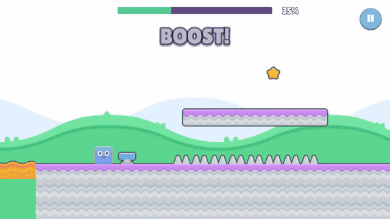

# Geo Game — web build

The browser version of **Geo Game**, a Geometry Dash–style runner made in Unity 6 with Visual Scripting.

**[▶ Play in the browser](https://dz-vadim.github.io/GeoGame-web/play/)** · [Trailer and screenshots](https://dz-vadim.github.io/GeoGame-web/)

Controls: <kbd>Space</kbd> or click to jump (hold to keep jumping), <kbd>Esc</kbd> to pause. Desktop browsers only for now.

This repository only holds the published site: `index.html` (landing page), `play/` (Unity WebGL build) and `media/` (trailer and screenshots).

## Credits

- Art and sound effects: [Kenney](https://kenney.nl) (CC0)
- Trailer music: “As fast as you can” by [Centurion_of_war](https://opengameart.org/content/as-fast-as-you-can) (CC0)
- Font: [Lilita One](https://fonts.google.com/specimen/Lilita+One) by Juan Montoreano (SIL Open Font License)
